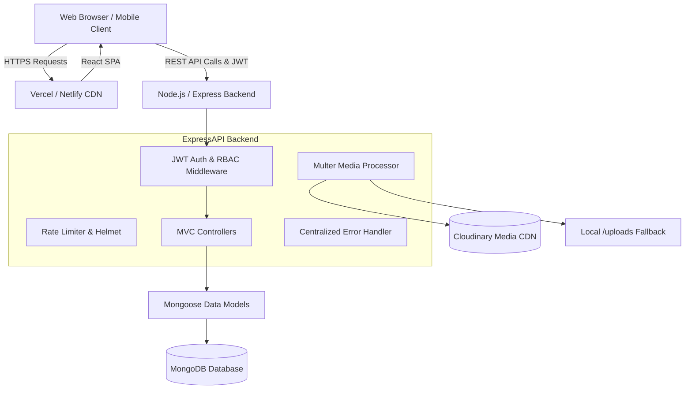

# RK STITCHES - System Architecture



---

## 1. Architectural Principles

### Separation of Concerns (MVC)
The backend decouples business logic from route specifications:
- **Routes**: Define HTTP verbs, URL path parameters, and attach middleware pipelines (`protect`, `restrictTo`).
- **Controllers**: Handle input parsing, interact with Mongoose models, format outputs, and delegate errors to `next(err)`.
- **Models**: Enforce data integrity, default values, pre-save hooks (e.g. password hashing with bcrypt, auto-generating `#RK-...` booking codes), and validation rules.

### Role-Based Access Control (RBAC)
Four strict roles exist:
1. `CUSTOMER`: Can create custom bookings, manage personal measurement profiles, save wishlists, and view personal notifications.
2. `STAFF`: Can view customer orders, update milestone statuses, and add tailor notes.
3. `ADMIN`: Full CRUD on services, fashion designs, gallery lookbook, video showcases, and review moderation.
4. `SUPER_ADMIN`: Root control over business configuration, staff roles, and analytics metrics.

### Dual-Mode Media Storage
Uploads can be routed either to **Cloudinary** (when cloud credentials are provided in `.env`) or to the local **`/uploads/` static directory** with zero application modifications or downtime.

---

## 2. Frontend State Architecture

```
State Container (Redux Toolkit)
├── auth
│   ├── user
│   ├── token
│   └── isAuthenticated
├── theme
│   └── darkMode (synced with 'dark' CSS class & localStorage)
├── wishlist
│   ├── items
│   └── count
└── ui
    ├── toasts
    ├── searchOpen
    └── activeVideo
```
- **Axios Interceptors**: Automatically inject JWT bearer tokens on all outgoing requests and gracefully intercept 401 expiration signals.
- **Micro-Animations**: Framer Motion and custom Tailwind keyframes deliver soft slide-ups and floating thread stitch animations without harming rendering performance.
